# Anomaly-Based Threat Detection Dashboard

A machine learning and cybersecurity project that detects suspicious system activity with **unsupervised anomaly detection (Isolation Forest)**, explains each finding with a **RAG pipeline grounded in MITRE ATT&CK**, and presents everything in an interactive **Streamlit dashboard** built for L1 SOC analysts.

> Academic Project – Data Mining and Machine Learning (DMML) | M.Tech Cybersecurity


---

## Overview

Rule-based security tools miss threats that don't match a known signature: unknown attacks, low-and-slow activity, and behavioural drift. This project learns what **normal** system behaviour looks like and flags anything that deviates from it, then turns each flagged event into a plain-language threat explanation that an analyst can act on.

It combines:
- **Isolation Forest** for unsupervised anomaly detection
- **Retrieval-Augmented Generation (RAG)** over a curated cybersecurity knowledge base
- **Rule-based MITRE ATT&CK mapping** of anomalous features to techniques
- **Shodan threat intelligence** lookups for IPs and domains
- **Interactive visualisation** with Streamlit and Plotly

---

## Results

On the evaluation dataset (1,000 normal events + 20 injected anomalies), the model flagged **21 events** and caught **every injected anomaly**:

| Metric | Score |
|---|---|
| Accuracy | **0.9990** |
| Precision | **0.9524** (20 of 21 flags were real anomalies) |
| Recall | **1.0000** (no anomaly missed) |
| F1 Score | **0.9756** |

Full output is in [`results/`](results/): metrics, confusion matrix, scatter plot and score distribution.

---

## Architecture

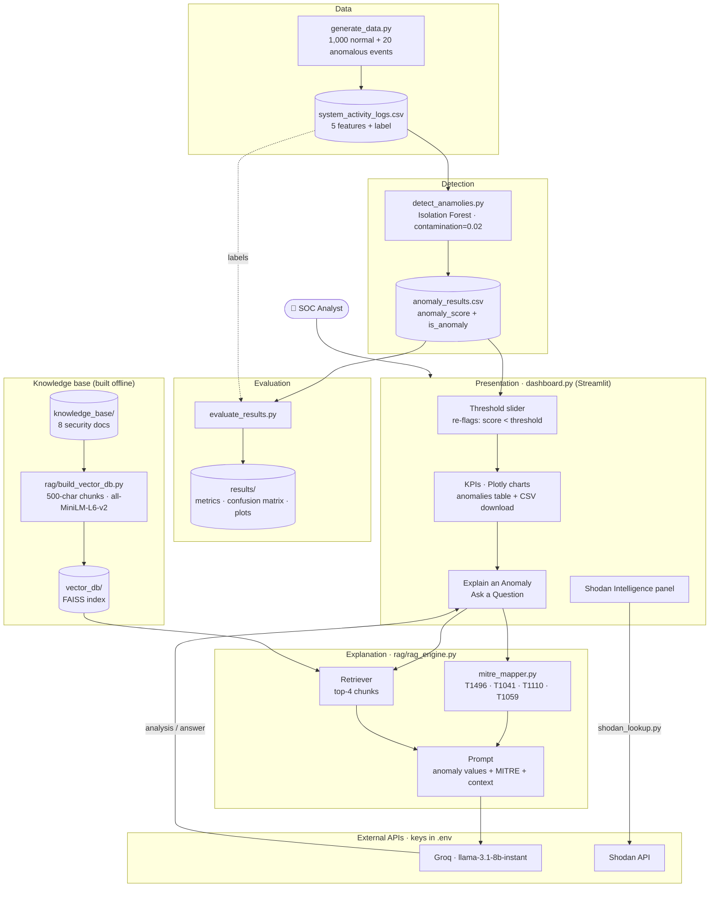

**Request flow when the analyst clicks "Generate Threat Explanation":**

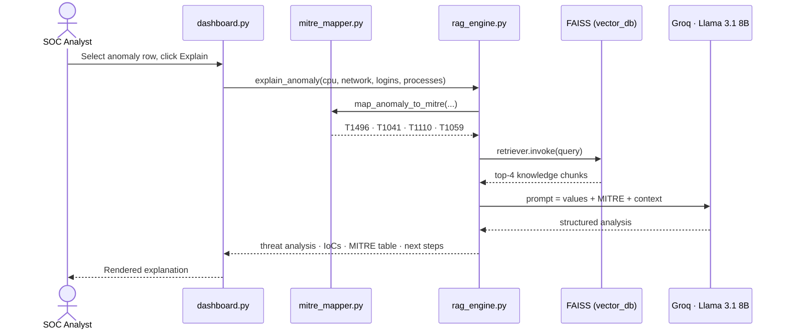

### How it works, step by step

1. **Data generation:** `generate_data.py` creates 1,000 normal events and 20 anomalous ones across five behavioural features: login attempts/min, files accessed/min, average CPU usage, outbound network traffic (MB) and process count.
2. **Detection:** `detect_anamolies.py` trains an **Isolation Forest** (`contamination=0.02`, `random_state=42`), then writes an `anomaly_score` and an `is_anomaly` flag for every event.
3. **Evaluation:** `evaluate_results.py` compares predictions against the ground-truth labels and saves the metrics and charts.
4. **Knowledge base:** `rag/build_vector_db.py` splits the eight knowledge-base documents into 500-character chunks, embeds them with `sentence-transformers/all-MiniLM-L6-v2` and stores them in a **FAISS** index.
5. **MITRE mapping:** `rag/mitre_mapper.py` maps anomalous values to ATT&CK techniques:

   | Condition | Technique |
   |---|---|
   | CPU > 80% | Resource Hijacking (T1496) |
   | Outbound traffic > 50 MB | Exfiltration Over C2 Channel (T1041) |
   | Login attempts > 10/min | Brute Force (T1110) |
   | Process count > 120 | Command and Scripting Interpreter (T1059) |

6. **Explanation:** `rag/rag_engine.py` retrieves the four most relevant knowledge chunks, combines them with the MITRE mapping, and asks a **Groq-hosted Llama 3.1 8B** model for a structured threat analysis or an answer to the analyst's question.

---

## 📸 Evidence: The Project in Action

### 1. Dashboard overview
The main dashboard summarises the run: **1,020 total events, 21 detected anomalies**, and the current threshold. The **CPU vs. network-out scatter plot** shows normal activity as a tight green cluster at low CPU and low traffic, while the anomalies (red) sit far away at 80–100% CPU and high outbound traffic. Below it, the **anomaly score histogram** shows the small group of strongly negative scores, left of the threshold line, that Isolation Forest isolated from the normal population.

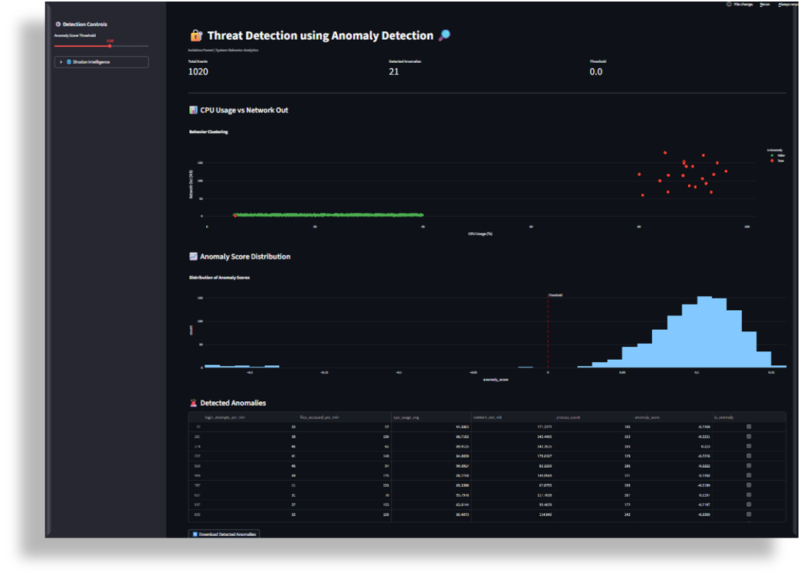

### 2. Input data: synthetic system activity logs
`data/system_activity_logs.csv` is the generated dataset that feeds the model. Each row is one observation window with the five behavioural features. These rows are typical normal activity: 0–2 logins/min, under 40% CPU and a few MB of outbound traffic.

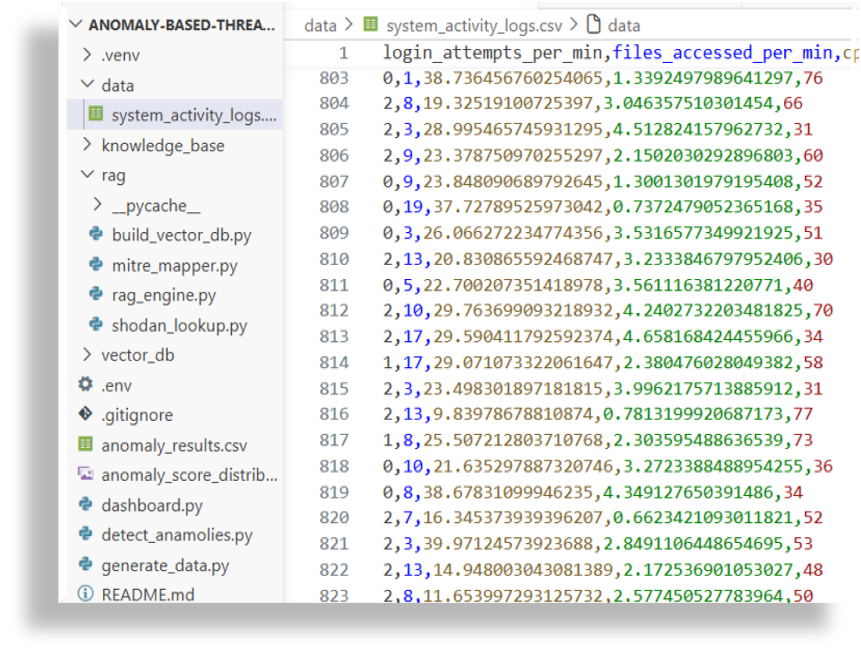

### 3. Model output: anomaly results
`anomaly_results.csv` is the detector's output: every event with its `anomaly_score` and `is_anomaly` flag (`1` = normal, `-1` = anomaly). Row 24 is a detected anomaly: **30 logins/min, 57 files accessed/min, 91.9% CPU, 171 MB outbound, 186 processes**, with a negative score of −0.227. That is the same event the explanation screenshots below analyse.

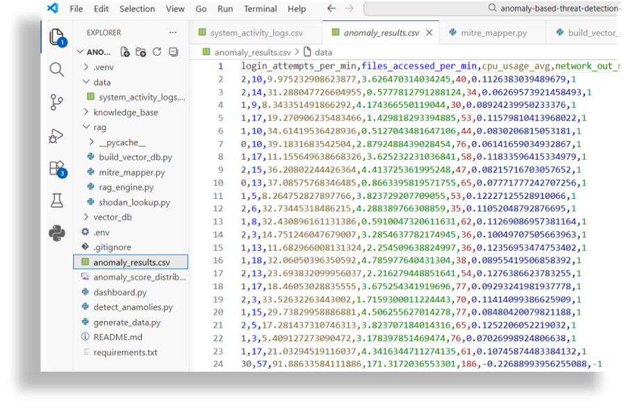

### 4. Detection controls and Shodan threat intelligence
The sidebar has an **anomaly-score threshold slider** that re-filters the detections live. It also has a **Shodan Intelligence** panel: an analyst enters an IP or domain and gets back the organisation, country, hostnames and open ports. Here, `184.24.16.157` resolves to Akamai Technologies (Netherlands) with ports 80 and 443 open, which helps the analyst judge whether an external endpoint is expected.

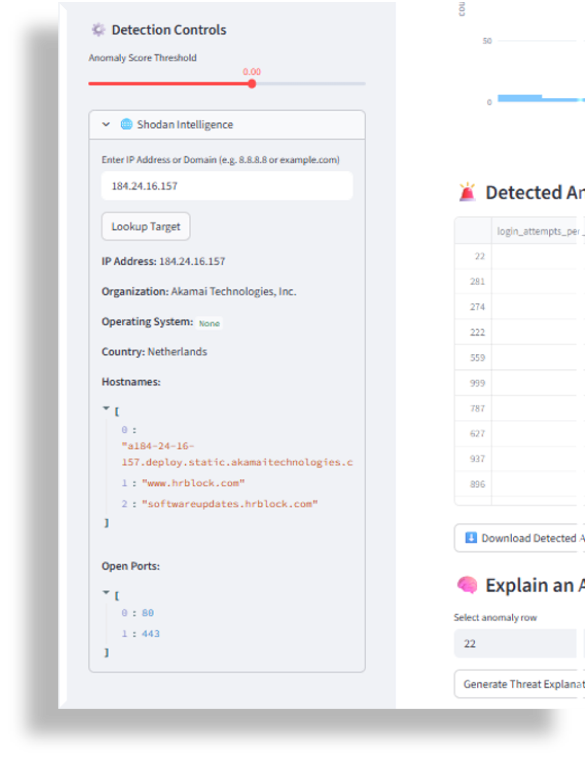

### 5. RAG knowledge base
The eight curated documents the RAG layer retrieves from cover authentication anomalies, botnet activity, data exfiltration, incident response, intrusion detection, malware behaviour, network anomalies and system-resource anomalies. Grounding the LLM in these documents keeps its explanations tied to security knowledge instead of guesswork.

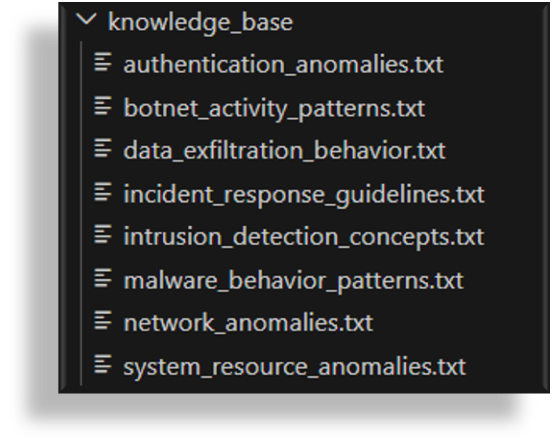

### 6. Embedding model loading
When the RAG engine starts, it loads the `sentence-transformers/all-MiniLM-L6-v2` embedding model (103/103 weights loaded). The FAISS index uses this same model to embed the analyst's query, so the query and the documents share one vector space.

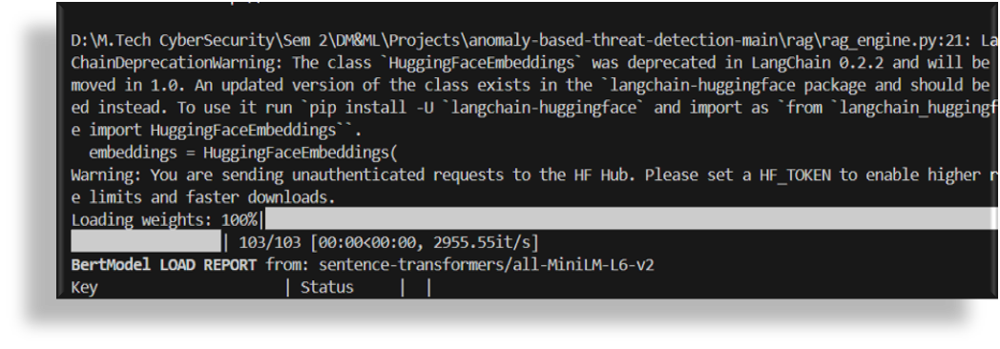

### 7. Retrieval step in code
The core of the RAG step: `retriever.invoke(query)` pulls the most relevant knowledge chunks from FAISS, and they are joined into one `context` block that goes to the LLM together with the anomaly's feature values and MITRE mapping.

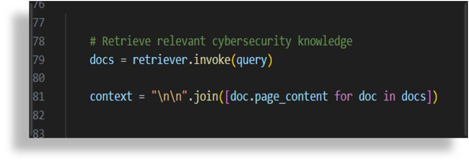

### 8. Explain an anomaly
The analyst picks an anomaly row (here **row 22**) and clicks **Generate Threat Explanation**. The model returns a structured analysis: threat summary, likely attack technique, indicators of compromise, MITRE ATT&CK mapping, recommended investigation steps and a final assessment.

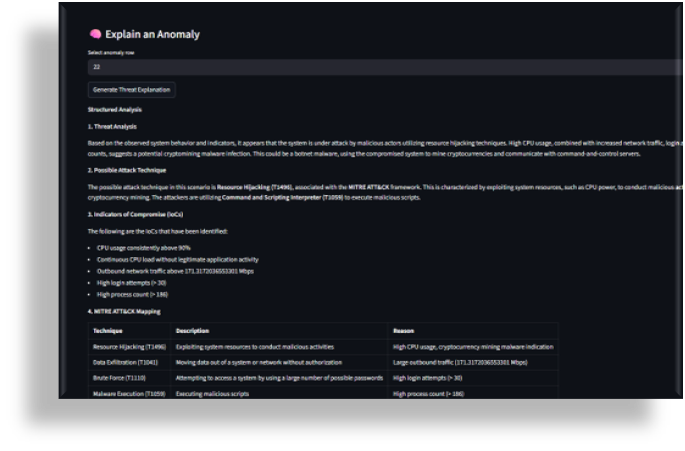

A closer look at the same report. The model concludes the behaviour is consistent with **resource hijacking (T1496)**, for example cryptomining by botnet malware. It lists concrete IoCs (CPU above 90%, 171 MB outbound, more than 30 login attempts, more than 186 processes) and gives five investigation steps: analyse the network traffic, profile the system, identify the malware, terminate the processes and segment the network.

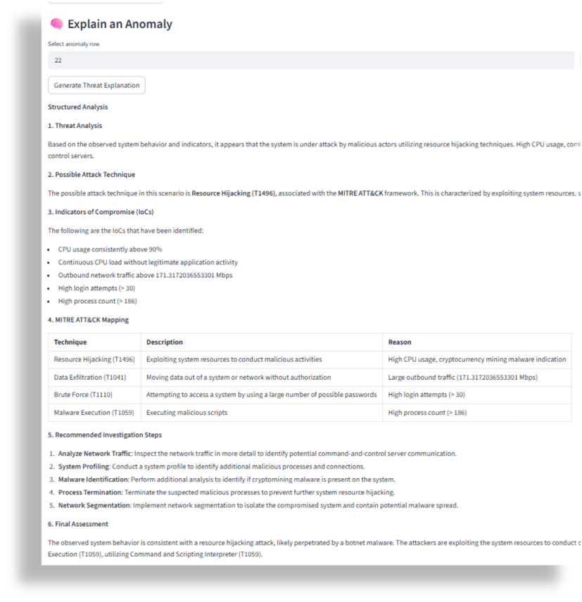

### 9. MITRE ATT&CK mapping
Each anomalous feature is mapped to a technique with the reason it was flagged: **T1496** for high CPU, **T1041** for large outbound traffic, **T1110** for high login attempts and **T1059** for a high process count. This lets an analyst move straight from a raw anomaly to the ATT&CK playbook for it.

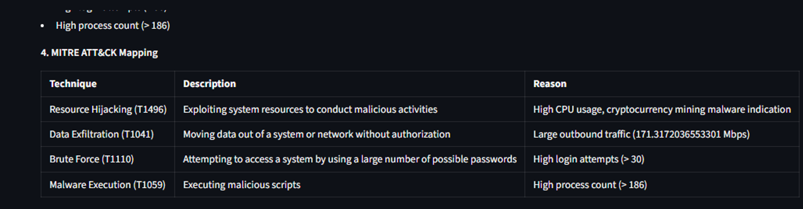

### 10. Ask a question about an anomaly
Analysts can ask free-text questions about the selected event. Asked *"What attack does this indicate?"*, the system reads the event's indicators (91.9% CPU, 171 MB outbound, 30 login attempts, 186 processes) and identifies a likely **brute force attack**, then justifies the verdict.

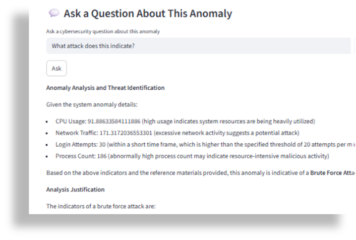

Asked *"Why is high CPU suspicious?"*, it explains that sustained high CPU can point to resource hijacking (T1496), cryptomining malware, botnet activity or trojans, and lists the related indicators to check.

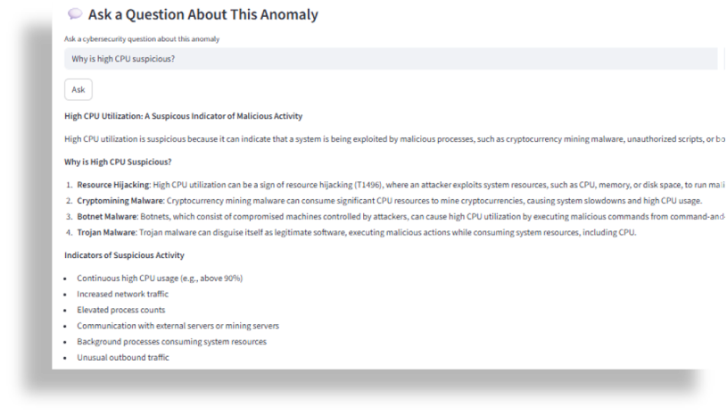

---

## Tech Stack

- **Python**, **Pandas**, **NumPy**
- **scikit-learn** (Isolation Forest, evaluation metrics)
- **Streamlit** and **Plotly** (dashboard), **Matplotlib** / **Seaborn** (charts)
- **LangChain**, **FAISS**, **Hugging Face sentence-transformers** (RAG)
- **Groq API** with **Llama 3.1 8B Instant** (explanations)
- **Shodan API** (threat intelligence)
- **MITRE ATT&CK** and **OWASP** (knowledge sources)

---

## Repository Structure

```text
├── dashboard.py              # Streamlit dashboard
├── generate_data.py          # Synthetic system activity data
├── detect_anamolies.py       # Isolation Forest training + scoring
├── evaluate_results.py       # Metrics and evaluation charts
├── anomaly_results.csv       # Scored events (model output)
├── requirements.txt
├── data/                     # system_activity_logs.csv
├── knowledge_base/           # 8 cybersecurity reference documents
├── rag/
│   ├── build_vector_db.py    # Builds the FAISS index
│   ├── rag_engine.py         # Retrieval + LLM explanations
│   ├── mitre_mapper.py       # Feature-to-ATT&CK rules
│   └── shodan_lookup.py      # Shodan IP/domain lookup
├── vector_db/                # FAISS index
├── results/                  # Metrics, confusion matrix, plots
└── docs/screenshots/         # Evidence screenshots used in this README
```

---

## How to Run

### 1. Clone the repository
```bash
git clone https://github.com/Subash-1507/Data_Mining_and_MachineLearning_project_new.git
cd Data_Mining_and_MachineLearning_project_new
```

### 2. Install dependencies
```bash
pip install -r requirements.txt
pip install huggingface-hub langchain-huggingface shodan
```

### 3. Add your API keys
Create a `.env` file in the project root. Don't commit it.
```env
GROQ_API_KEY=your_groq_api_key
SHODAN_API_KEY=your_shodan_api_key
```

### 4. Generate data and build the vector database
```bash
python generate_data.py
python rag/build_vector_db.py
```

### 5. Run detection and evaluation
```bash
python detect_anamolies.py
python evaluate_results.py
```

### 6. Launch the dashboard
```bash
streamlit run dashboard.py
```

---

## Use Cases

- L1 SOC analyst triage support
- Security operations monitoring
- Threat hunting and insider-threat detection
- System behaviour anomaly analysis
- Cybersecurity education and academic demonstration

---

## Future Improvements

- Live log ingestion instead of synthetic data
- Real-time alerting and notifications
- More threat intelligence sources
- Authentication and role-based access for the dashboard
- Broader evaluation on real-world datasets

---

## Author

**Subash Chandra Bose** ([@Subash-1507](https://github.com/Subash-1507))
**SSV-07 Vaagai**

M.Tech Cybersecurity · [LinkedIn](https://www.linkedin.com/in/subash-chandra-bose-014bb21b5)
